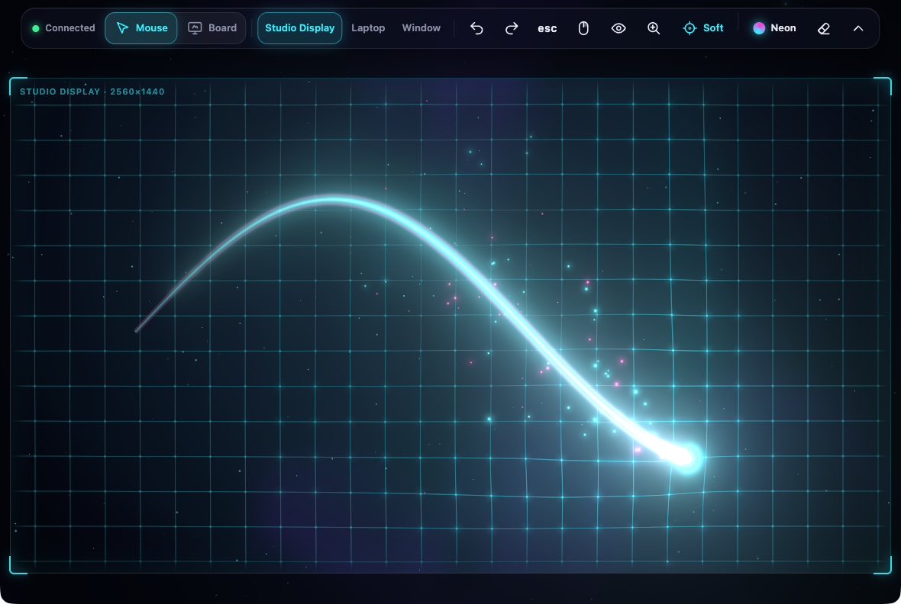
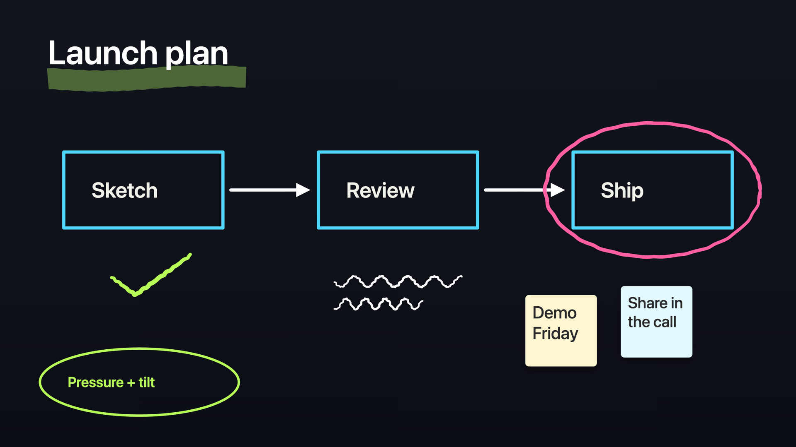

<p align="center">
  
</p>

#  PencilPad

**Your iPad and Apple Pencil, working as a drawing tablet for your Mac.**

PencilPad turns an iPad and an Apple Pencil into a pen tablet for your Mac over your local network. There is nothing to install on the iPad. The Mac app serves a web page, you open it in Safari and add it to the Home Screen, and the Pencil starts driving the cursor.

Everything runs on your own network. Nothing loads from the internet while you use it.

## Pencil in, cursor out

- Only the Pencil moves the cursor. Palms and fingers never click.
- Fingers press the buttons on the page. Tap Zoom, then pinch or drag to zoom into part of a screen.
- Pressure and tilt are sent along with every point, so pressure-aware apps respond.
- Pick a whole screen or a single Mac window as the target.

## Mouse mode and Board mode

- Mouse mode: the Pencil drives the Mac cursor on the screen or window you picked.
- Board mode: the Pencil draws into a Board window on the Mac, and no mouse or key events are sent.
- Switch modes from the iPad page.

## The Board window



- A plain Mac window that shows only the drawing, so you can share it in a video call.
- Pen, marker, and eraser, plus shapes (line, arrow, rectangle, ellipse), text labels, and sticky notes.
- Paste an image from the Mac clipboard onto the board.
- Copy the board to the clipboard as a PNG, or save it to the Desktop as a PNG.
- Backgrounds: dark, white, grid, or dots. Undo and redo are on the iPad toolbar.

## Show mode

- Show streams the target Mac window or screen onto the iPad, so you can see what you are drawing on.
- Tap Zoom and pinch into part of a screen, and the stream follows the part you zoomed to.
- The picture is drawn over the page effects, and the Pencil keeps driving the Mac while it shows.

## Features

- Works over the local network only, with nothing loading from the internet.
- No app to install on the iPad. It is a web page you add to the Home Screen.
- A secure link with a token pairs the iPad. No input is accepted until the page proves that token.
- Pencil only for the cursor, so a resting palm does nothing.
- Mouse mode and Board mode, picked on the iPad.
- Board window made for sharing in a video call.
- Show mode projects a Mac window or screen onto the iPad.
- Undo, redo, and Escape buttons send those keys to the Mac.
- Menu bar app with no Dock icon. It opens at login once it is installed in Applications.

## Install

Requirements: macOS 15 or later, the Xcode Command Line Tools, and an iPad with an Apple Pencil on the same network.

```sh
git clone https://github.com/DHRlabs/pencil-pad.git
cd pencil-pad
bash scripts/build-app.sh --install
```

That builds the app, puts it in `/Applications/PencilPad.app`, and opens it. The script signs with your Apple Development certificate when you have one. Without one the build is signed ad hoc and macOS asks for Accessibility again after each rebuild.

## Setup

1. Allow **Accessibility** when PencilPad asks at launch, so it can control the cursor. Allow **Local Network** access if macOS asks.
2. Click the pencil icon in the menu bar and choose **Copy iPad link**.
3. Open that link in Safari on the iPad.
4. Tap Share, then **Add to Home Screen**, and open PencilPad from the Home Screen.
5. Allow **Screen Recording** for PencilPad if you want to use Show.
6. Set the iPad's Auto-Lock to **Never** while you use it, so the page stays awake.

## How it works

The Mac app serves the iPad page over HTTP on port 8710 and takes Pencil input over a WebSocket on port 8711. The page URL includes a token, and the first frame on the socket has to prove that token or the Mac closes the connection. The page draws with three.js, which is vendored in the app, so nothing is fetched from the internet at runtime. One iPad is connected at a time. If the connection drops in the middle of a stroke, the Mac releases the mouse button.

## Requirements and notes

- macOS 15 or later.
- Accessibility is needed for cursor control. Screen Recording is needed for Show.
- The iPad and the Mac have to be on the same local network.
- Pasted board images are stored on the Mac, not on the iPad.
- The board is saved on the iPad, so reloading the page keeps your drawing.

## License

PencilPad is licensed under the [GNU General Public License v3.0](LICENSE). The bundled three.js is MIT; its license is in `web/vendor/LICENSE-three.txt`.
